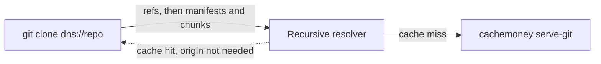

<p align="center">
  
</p>

<p align="center"><b>Content-addressed objects over DNS.</b> Git objects, packages, and blobs, resolvable through TXT and AAAA records.</p>

<p align="center">
  <a href="https://github.com/Crank-Git/cachemoney/actions/workflows/test.yml"></a>
  
  <a href="LICENSE"></a>
</p>

<p align="center">
  <a href="docs/addressing.md"><b>Docs</b></a> ·
  <a href="#install"><b>Install</b></a> ·
  <a href="#quick-start"><b>Quick start</b></a>
</p>



## Why cachemoney

Content-addressed data never changes, so caching it is always correct. A resolver that
fetched an object once can serve it until the TTL runs out, and the bytes can't drift. Put
those objects in DNS with long TTLs and every resolver in the path turns into a CDN for
free.

So every chunk lives at a name derived from its own hash, with a one-day TTL. The only
mutable record is a repository's ref list at `<repo>.refs.<zone>`, with a 60-second TTL;
everything it points at is immutable. A client walks the graph from there and checks every
chunk hash and every git SHA-1 before it trusts a byte.

Git itself never knows any of this happened. It hands `dns://` URLs to the
`git-remote-dns` helper, and the helper does the walking.

## Requirements

- **Go 1.27** or later.
- **git**, for `serve-git` and for cloning.
- **Unbound**, only if you want to run the recursive-resolver test locally.

## Install

```sh
go install github.com/Crank-Git/cachemoney/cmd/cachemoney@latest
go install github.com/Crank-Git/cachemoney/cmd/git-remote-dns@latest
```

`git-remote-dns` has to be on your `PATH`, because that's where git looks for the helper
when it sees a `dns://` URL. There are no release binaries yet.

## Quick start

Serve a repository from inside its working tree:

```sh
cd path/to/repo
cachemoney serve-git -name myrepo -addr 127.0.0.1:5300
```

`serve-git` publishes every branch and tag plus HEAD, prints the exact clone command, and
re-reads the repository every 30 seconds. In another terminal, clone it:

```sh
export GIT_REMOTE_DNS_ZONE=example.com GIT_REMOTE_DNS_SERVER=127.0.0.1:5300
git clone dns://myrepo
git -C myrepo pull
```

Later pulls fetch only new objects. To clone the history of one commit instead, use its
SHA: `git clone dns://<40-character sha>`. The zone defaults to `example.com`; set `-zone`
on the server and `GIT_REMOTE_DNS_ZONE` on the client to change it.

Every object is verified by its SHA, but the ref list isn't. Which commit a branch names
is only as trustworthy as the DNS path that delivered it.

## Usage

`cachemoney` has five subcommands: `put`, `get`, `serve`, `serve-git`, and `fetch`. For
any blob, store it locally, serve the store, and fetch it back over DNS:

```console
$ cachemoney put hello.txt
object  A77U4MYEEYZT5SUOQDPQ5ONKM4QJYBU6N5LOVTHDBLXV3RPODGPA
chunks  1
bytes   19
store   .cachemoney
$ cachemoney serve -addr 127.0.0.1:8845 &
$ cachemoney fetch -addr 127.0.0.1:8845 A77U4MYEEYZT5SUOQDPQ5ONKM4QJYBU6N5LOVTHDBLXV3RPODGPA
hello over port 53
```

`put` and `get` work on the store in `.cachemoney` (`-store` changes it). `serve`, `serve-git`,
and `fetch` take `-zone` and `-tr txt|aaaa` to pick the zone and the record type that
carries the payload.

## Documentation

| Page | What's there |
|---|---|
| [Addressing and framing](docs/addressing.md) | Record names, the graph walk, TXT and AAAA framing, TTLs, and server behavior. |
| [Git over DNS](docs/git-over-dns.md) | `serve-git` flags, the helper protocol, its environment variables, and the Go API. |
| [Open questions](docs/open-questions.md) | Where the records live and how to trust refs. |
| [Contributing](CONTRIBUTING.md) | Branch model, CI checks, and repository layout. |

## Development

```sh
go build ./...
go test -race -cover ./...
go vet ./...
```

The Unbound test is skipped if `unbound` isn't installed. CI requires it.

## License

MIT. See [LICENSE](LICENSE).

---

<sub>Part of <a href="https://github.com/Crank-Git#things-over-port-53"><b>Things over port 53</b></a>,
my experiments in what else DNS can carry.
Siblings: <a href="https://github.com/Crank-Git/epochalypse">epochalypse</a> ·
<a href="https://github.com/Crank-Git/mcport53">mcport53</a> ·
<a href="https://github.com/Crank-Git/wingman">wingman</a> ·
<a href="https://github.com/Crank-Git/llamaoverdns">llamaoverdns</a> ·
<a href="https://github.com/Crank-Git/dnscalc">dnscalc</a> ·
Built by <a href="https://github.com/Crank-Git">Crank</a></sub>
